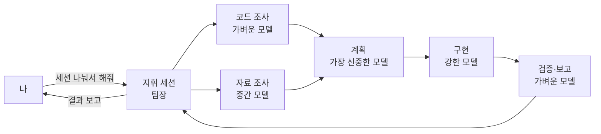

# orchestrate-sessions

**큰 일을 여러 AI 세션에 나눠 맡기고, 한 세션이 팀장처럼 지휘하게 만드는 Claude Code 스킬입니다.**

> English: A Claude Code skill that splits big work into sub-sessions with fitting models. Docs in Korean. AI agents: start with [FOR-AI.md](FOR-AI.md).

## 이게 뭔가요?

- **팀장(지휘 세션)**: 일을 나누고, 담당을 정하고, 결과를 검사
- **팀원(서브 세션)**: 자기 단계 하나만 처리



## 왜 이렇게 하나요?

1. **비용이 줄어요.**
2. **알맞은 모델을 써요.**
3. **실수가 덜 새요.**
4. **흐름이 기록돼요.**

## 이런 일에 어울려요 / 안 어울려요

| 어울려요 | 안 어울려요 |
|---|---|
| 여러 단계가 필요한 기능 개발 | 오타 고치기, 질문 하나 |
| 조사 결과를 문서로 남기는 일 | 몇 분이면 끝나는 수정 |
| 몇 시간 이상 걸리는 큰 작업 | 비용을 최소로 하고 싶을 때 |

## 준비물

- Claude Code 데스크톱 앱
- Claude 유료 요금제
- git 저장소 (권장)

## 설치

### 방법 1. AI에게 맡기기 (가장 쉬움)

```text
https://github.com/cykim-bs/orchestrate-sessions 의 FOR-AI.md를 읽고, 내 컴퓨터에 설치할지 판단한 뒤 설치해 줘.
```

### 방법 2. 설치 스크립트

Windows:

```powershell
git clone https://github.com/cykim-bs/orchestrate-sessions.git
cd orchestrate-sessions
powershell -ExecutionPolicy Bypass -File .\scripts\install.ps1
```

macOS / Linux:

```bash
git clone https://github.com/cykim-bs/orchestrate-sessions.git
cd orchestrate-sessions
./scripts/install.sh
```

| 옵션 | Windows | macOS·Linux |
|---|---|---|
| 덮어쓰기 | `-Force` | `--force` |
| 미리 보기 | `-WhatIf` | `--dry-run` |
| 한 프로젝트에만 | `-Project <폴더>` | `--project <폴더>` |

### 방법 3. 직접 복사

| 이 저장소의 | 여기로 복사 |
|---|---|
| `skills/orchestrate-sessions/` | `~/.claude/skills/orchestrate-sessions/` |
| `rules/model-effort-by-task.md` | `~/.claude/rules/model-effort-by-task.md` |

설치 뒤 **새 대화**부터 적용됩니다.

## 사용법

1. **부탁하기**

   ```text
   설정 화면에 다크 모드를 추가해 줘. 서브세션으로 나눠서 진행해 줘.
   ```

2. **첫 질문에 한 번 답하기** (push 여부, 계획 확인 여부 등)
3. **기다리기**
4. **결과 받기**
5. **(선택) 회고**: 「지휘 회고 해 줘」

> **팁:** 지휘 세션은 Opus · high로 시작하세요.

## 단계별 기본 모델

| 단계 | 모델 · 추론 수준 |
|---|---|
| 코드 조사 | Sonnet · medium |
| 자료 조사 | Opus · medium |
| 계획 | Opus · xhigh |
| 구현 | Opus · high |
| 검증·보고 | Sonnet · medium |
| 지휘 | Opus · high |

## 내 환경에 맞추기 (선택)

`references/local-bindings.example.md` → `local-bindings.md`로 복사해서 고치기

## 용어 풀이

| 용어 | 뜻 |
|---|---|
| 세션 | AI와 나누는 대화 하나 |
| 서브에이전트 | 세션 안에서 잠깐 부르는 보조 AI |
| 모델 | Opus(신중) · Sonnet(균형) · Haiku(빠름) |
| 추론 수준 | 얼마나 깊이 생각할지 (low ~ max) |
| 맥락 | AI가 다시 읽는 지금까지의 대화 |
| 브리프 | 서브 세션에 주는 작업 지시서 |
| 스킬 / 룰 | 필요할 때 읽는 설명서 / 항상 지키는 규칙 |

## 자주 묻는 질문

- **Q. 오히려 비싸지 않나요?** 작은 일에선 그럴 수 있어요.
- **Q. 중간에 멈추려면?** 「멈춰」라고 하세요.
- **Q. 다른 AI 도구에서도 되나요?** 원칙만 빌려 쓸 수 있어요. [FOR-AI.md](FOR-AI.md)

## 주의

- **앱 버전에 따라 동작이 바뀔 수 있어요.** (2026년 11월 기준)
- **여러 세션이 동시에 돌면 사용량이 늘어요.**
- **`local-bindings.md`에 비밀번호를 적지 마세요.**

## 파일 구성

```text
orchestrate-sessions/
├─ README.md
├─ FOR-AI.md                   ← AI용 안내
├─ skills/orchestrate-sessions/ ← 스킬
├─ rules/                       ← 룰
├─ examples/walkthrough.md      ← 따라가기 예시
└─ scripts/                     ← 설치 스크립트
```

## 라이선스

[MIT](LICENSE)
