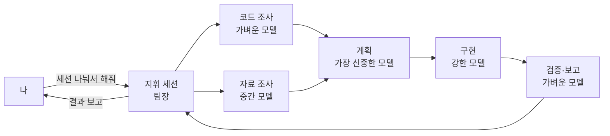

# orchestrate-sessions

**큰 일을 여러 AI 세션에 나눠 맡기고, 한 세션이 팀장처럼 지휘하게 만드는 Claude Code 스킬입니다.**

> English summary: A Claude Code skill + rule that lets one "conductor" session split a big task into stages (research → plan → implement → verify → report), start a sub-session for each stage with a fitting model and reasoning effort, and check each result itself before moving on. Docs are in Korean. For AI agents, start with [FOR-AI.md](FOR-AI.md).

---

## 이게 뭔가요?

AI에게 큰 일을 맡기면 보통 대화 하나에서 처음부터 끝까지 다 합니다. 조사도, 계획도, 코드 작성도, 테스트도요.
이 스킬을 쓰면 일하는 방식이 **팀**처럼 바뀝니다.

- **팀장(지휘 세션)** 한 명이 일을 단계로 나누고, 단계마다 담당자를 정하고, 결과를 직접 검사합니다.
- **팀원(서브 세션)** 은 자기 단계 하나만 맡아서 끝냅니다. 어려운 설계에는 똑똑한 모델을, 단순한 검색·정리에는 빠르고 싼 모델을 씁니다.



단계가 끝날 때마다 팀장이 결과물을 **직접 확인**한 뒤에 다음 단계를 시작합니다. 팀원의 「다 했어요」라는 말만 믿지 않습니다.

## 왜 이렇게 하나요?

1. **비용이 줄어요.** AI는 답할 때마다 지금까지의 대화를 전부 다시 읽습니다. 대화가 길어질수록 한 번 답할 때 드는 비용이 커져요. 단계마다 새 세션으로 끊으면 각 세션의 대화가 짧게 유지됩니다.
2. **알맞은 모델을 써요.** 파일 찾기에 가장 비싼 모델을 쓸 필요는 없고, 설계에는 가장 신중한 모델이 필요합니다. 단계마다 모델과 「얼마나 깊이 생각할지(추론 수준)」를 따로 정합니다.
3. **실수가 덜 새요.** 팀장이 단계 사이에 결과를 검사합니다. 허락받지 않은 일(push, 배포, 다운로드, 메시지 보내기)은 아무 세션도 하지 않습니다.
4. **흐름이 기록돼요.** 어떤 세션이 무엇을 했는지 진행표(`sessions.md`)에 남습니다. 대화가 길어져 앞부분이 요약돼도 이어서 할 수 있습니다.

## 이런 일에 어울려요 / 안 어울려요

| 어울려요 | 안 어울려요 |
|---|---|
| 조사 → 계획 → 구현 → 테스트까지 여러 단계가 필요한 기능 개발 | 오타 고치기, 질문 하나에 답하기 |
| 조사할 것이 많고 결과를 문서로 남겨야 하는 일 | 몇 분이면 끝나는 작은 수정 |
| 몇 시간 이상 걸리는 큰 작업 | 비용·세션 수를 최소로 하고 싶을 때 |

작은 일에 쓰면 세션을 띄우고 검사하는 비용이 더 들 수 있어요. 스킬도 작은 일은 지휘 세션이 직접 처리하도록 되어 있습니다.

## 준비물

- **Claude Code 데스크톱 앱**(Claude 데스크톱 앱의 *Code* 탭)
  - 이 앱에는 AI가 새 세션을 띄우고, 모델을 정하고, 끝나면 알림을 받는 기능이 있어요. 이 스킬은 그 기능을 씁니다.
  - 터미널용 CLI, 웹, IDE 확장에서는 이 기능이 없을 수 있어요. 그 경우 AI가 세션 대신 「서브에이전트」로 같은 단계를 진행하고, 그렇게 바꾼다고 알려 줍니다.
- Claude 유료 요금제(여러 모델을 고를 수 있는 것)
- (권장) 작업할 프로젝트가 git 저장소일 것. 단계마다 커밋해서 무엇이 바뀌었는지 추적합니다.

## 설치

세 가지 방법 중 편한 것 하나를 고르세요. 모두 같은 결과입니다.

### 방법 1. AI에게 맡기기 (가장 쉬움)

Claude Code에 이렇게 말하세요.

```text
https://github.com/cykim-bs/orchestrate-sessions 의 FOR-AI.md를 읽고, 내 컴퓨터에 설치할지 판단한 뒤 설치해 줘.
```

AI가 내 환경에서 쓸 수 있는지 확인하고, 파일을 알맞은 곳에 복사합니다.

### 방법 2. 설치 스크립트

저장소를 내려받은 폴더에서 실행합니다.

Windows (PowerShell):

```powershell
git clone https://github.com/cykim-bs/orchestrate-sessions.git
cd orchestrate-sessions
powershell -ExecutionPolicy Bypass -File .\scripts\install.ps1
```

`-ExecutionPolicy Bypass`는 이 스크립트 한 번만 실행을 허용한다는 뜻이에요. 컴퓨터 설정은 바뀌지 않습니다.

macOS / Linux:

```bash
git clone https://github.com/cykim-bs/orchestrate-sessions.git
cd orchestrate-sessions
./scripts/install.sh
```

- 이미 같은 이름의 파일이 있으면 건드리지 않고 알려 줍니다. 덮어쓰려면 `-Force`(Windows) / `--force`(macOS·Linux)를 붙이세요. 기존 파일은 `~/.claude/orchestrate-sessions-backup/<날짜시각>/`에 옮겨 두고, 내가 만든 `local-bindings.md`는 새 설치에 그대로 옮깁니다.
- 미리 보기만 하려면 `-WhatIf` / `--dry-run`.
- 한 프로젝트에만 설치하려면 `-Project <프로젝트 폴더>` / `--project <프로젝트 폴더>`.

### 방법 3. 직접 복사

| 이 저장소의 | 여기로 복사 (모든 프로젝트에서 쓰기) | 또는 여기로 (한 프로젝트에서만) |
|---|---|---|
| `skills/orchestrate-sessions/` 폴더 | `~/.claude/skills/orchestrate-sessions/` | `<프로젝트>/.claude/skills/orchestrate-sessions/` |
| `rules/model-effort-by-task.md` | `~/.claude/rules/model-effort-by-task.md` | `<프로젝트>/.claude/rules/model-effort-by-task.md` |

`~`는 내 사용자 폴더입니다. Windows라면 `C:\Users\<내 이름>`, macOS라면 `/Users/<내 이름>`이에요.

설치한 뒤에는 Claude Code에서 **새 대화**를 시작해야 적용됩니다.

## 사용법

### 1. 부탁하기

데스크톱 앱의 Code 탭에서 프로젝트 폴더를 열고, 평소처럼 일을 말한 뒤 끝에 붙이면 됩니다.

```text
설정 화면에 다크 모드를 추가해 줘. 서브세션으로 나눠서 진행해 줘.
```

다른 표현도 됩니다: 「세션 나눠서 시켜」, 「지휘해줘」, 「단계마다 알맞은 모델로 해줘」.

> **팁:** 지휘 세션의 모델과 추론 수준은 앱 화면에서 **내가** 고릅니다. 지휘는 Opus · high 정도를 권합니다. 계획 단계에 가장 깊은 생각(xhigh)이 필요한 큰 일이라면 지휘도 그만큼 높게 시작하세요. 서브 세션에 지휘보다 높은 수준을 못 줄 수 있습니다.

### 2. 첫 질문에 한 번 답하기

지휘 세션은 단계와 담당 모델 표를 보여 주고, 조사 세션을 먼저 띄운 다음 **한 번에** 몇 가지를 물어봅니다.

- 마지막에 원격 저장소로 push까지 할까요?
- 계획을 먼저 확인하고 구현할까요?
- 새 패키지·파일을 내려받아도 될까요?

이 답은 「허락」으로 기록되고, 해당 단계 세션에 **내가 한 말 그대로** 전달됩니다. 허락하지 않은 일은 어떤 세션도 하지 않아요.

### 3. 기다리기

서브 세션들은 앱 왼쪽 사이드바에 따로 보입니다. 눌러서 지켜보거나 직접 말을 걸 수도 있어요.
세션 하나가 끝나면 지휘 세션이 자동으로 깨어나 결과를 검사하고 다음 단계를 띄웁니다. 「끝났어?」라고 물어볼 필요는 없습니다.

### 4. 결과 받기

마지막에 지휘 세션이 정리해서 알려 줍니다: 무엇이 바뀌었는지, 검사 결과, 커밋 목록, 하지 않은 일, 단계별로 어떤 모델을 썼는지.

진행표는 기본으로 프로젝트 안 `.orchestration/<날짜-작업명>/sessions.md`에 남습니다. git에 올리고 싶지 않다면 `.gitignore`에 `.orchestration/`을 추가하세요.

### 5. (선택) 회고

몇 번 써 본 뒤 「지휘 회고 해 줘」라고 하면, 지난 세션들을 모아 「이 단계는 더 싼 모델로 충분했다」 같은 판단을 표로 만들어 줍니다. 모델 배정 표를 내 상황에 맞게 다듬을 때 씁니다.

## 단계별 기본 모델

| 단계 | 하는 일 | 기본 모델 · 추론 수준 |
|---|---|---|
| 코드 조사 | 프로젝트 코드를 읽고 관련 부분 정리 | Sonnet · medium |
| 자료 조사 | 웹·문서에서 방법과 사례 찾기 | Opus · medium |
| 계획 | 구현 단위, 완료 기준, 검증 방법 정하기 | Opus · xhigh |
| 구현 | 코드 작성, 단위별 커밋 | Opus · high (작으면 medium) |
| 검증·보고 | 테스트·빌드, 문서 정리, push | Sonnet · medium |
| 지휘 | 나누기, 브리프 쓰기, 검사 | Opus · high (내가 고름) |

작은 단계는 합쳐서 세션 수를 줄입니다(예: 조사+계획을 한 세션으로). 표는 `rules/model-effort-by-task.md`에서 바꿀 수 있어요.

## 내 환경에 맞추기 (선택)

내 프로젝트만의 규칙이 있다면 `skills/orchestrate-sessions/references/local-bindings.example.md`를 같은 폴더에 `local-bindings.md`로 복사해서 고치세요. 지휘 세션이 시작할 때 읽습니다.

적을 수 있는 것:
- 진행표를 둘 위치
- 답변 언어·말투
- 커밋 메시지 형식, push 기본값, 여러 세션이 동시에 작업할 때 폴더를 나누는 방법
- 여러 세션이 동시에 쓰면 안 되는 것(에디터, DB 등)과 잡고 놓는 순서
- 결과를 팀 채팅 등에 보고하는 방법(기본은 보고하지 않음)

## 용어 풀이

| 용어 | 뜻 |
|---|---|
| 세션 | AI와 나누는 대화 하나. 앱 사이드바의 한 줄입니다. |
| 지휘 세션 / 서브 세션 | 일을 나누고 검사하는 세션 / 한 단계를 맡아 처리하는 세션 |
| 서브에이전트 | 한 세션 안에서 잠깐 불러 쓰는 보조 AI. 결과만 돌려주고 사라집니다. 사이드바에 따로 보이지 않습니다. |
| 모델 | AI의 종류. Opus(신중·강함·비쌈), Sonnet(균형), Haiku(빠름·쌈). |
| 추론 수준(effort) | 답하기 전에 얼마나 깊이 생각할지. low < medium < high < xhigh < max. 높을수록 느리고 비쌉니다. |
| 맥락(context) | AI가 답할 때 다시 읽는 지금까지의 대화 전체. 길수록 비쌉니다. |
| 브리프 | 지휘가 서브 세션에 주는 작업 지시서. 서브 세션은 이 글만 보고 일합니다. |
| 스킬 | 특정 일을 하는 방법을 적어 둔 설명서. 필요할 때 AI가 꺼내 읽습니다. |
| 룰 | AI가 항상 지키는 짧은 규칙. 모든 대화에 자동으로 실립니다. |
| 커밋 / push | 바뀐 내용을 저장소에 기록 / 그 기록을 GitHub 같은 원격 저장소에 올리기 |

## 자주 묻는 질문

**Q. 세션을 여러 개 띄우면 오히려 비싸지 않나요?**
작은 일에서는 그럴 수 있어요. 큰 일에서는 한 대화가 계속 길어지는 비용이 더 커서, 나누는 쪽이 대체로 쌉니다. 회고 기능으로 실제로 어땠는지 확인할 수 있어요.

**Q. 중간에 멈추고 싶어요.**
지휘 세션에 「멈춰」라고 하거나, 사이드바에서 해당 서브 세션을 직접 멈추면 됩니다. 진행표가 남아 있으니 나중에 「이어서 해 줘」로 계속할 수 있어요.

**Q. 서브 세션이 내 파일을 마음대로 바꾸거나 올리지 않나요?**
브리프에 작업 범위와 허락 범위가 적혀 있고, 범위 밖이 필요하면 멈춰서 지휘에게 돌려줍니다. 그래도 앱의 권한 설정(파일 수정·명령 실행 허용 여부)은 평소처럼 적용되니, 처음에는 확인하면서 쓰세요.

**Q. 두 세션이 같은 파일을 동시에 고치면요?**
기본 규칙은 「같은 폴더를 쓰는 세션은 한 번에 하나」입니다. 병렬로 고쳐야 하면 세션마다 따로 작업 폴더(git 워크트리나 별도 클론)를 줍니다. 어느 쪽을 쓸지는 `local-bindings.md`에서 정할 수 있어요.

**Q. Cursor나 다른 AI 도구에서도 되나요?**
스킬 파일은 마크다운 문서라 다른 도구의 AI도 읽고 참고할 수 있어요. 다만 「세션을 띄우고 끝나면 알림 받기」는 Claude Code 데스크톱 앱 기능이라, 다른 도구에서는 단계 나누기·모델 배정·검사 원칙만 빌려 쓰게 됩니다. [FOR-AI.md](FOR-AI.md)에 판단 기준이 있습니다.

**Q. 모델 이름이 바뀌면요?**
문서는 Opus·Sonnet·Haiku 같은 모델 계열 이름만 씁니다. 실제 모델 id는 AI가 그때그때 최신 목록에서 고릅니다.

## 주의

- 세션 도구의 이름과 동작은 앱 버전에 따라 바뀔 수 있어요. 이 문서는 2026년 11월 기준으로 확인했습니다.
- 여러 세션이 동시에 돌면 사용량이 한꺼번에 늘어납니다. 요금제 한도를 확인하세요.
- `local-bindings.md`에 토큰·비밀번호를 적지 마세요.

## 파일 구성

```text
orchestrate-sessions/
├─ README.md                  ← 지금 이 문서 (사람용 안내)
├─ FOR-AI.md                  ← AI가 읽고 설치·적용 여부를 판단하는 안내
├─ skills/orchestrate-sessions/
│   ├─ SKILL.md               ← 스킬 본문 (지휘 절차)
│   └─ references/
│       ├─ brief-template.md        ← 서브 세션 지시서 틀
│       ├─ sessions-template.md     ← 진행표 틀
│       ├─ retrospective.md         ← 회고 절차
│       └─ local-bindings.example.md ← 내 환경 규칙 예시
├─ rules/model-effort-by-task.md   ← 일별 모델·추론 수준 표 (항상 적용되는 룰)
├─ examples/walkthrough.md    ← 가상 작업 하나를 처음부터 끝까지 따라가 보는 예시
└─ scripts/install.ps1, install.sh ← 설치 스크립트
```

## 라이선스

[MIT](LICENSE). 자유롭게 고쳐 쓰고 나눠도 됩니다.
